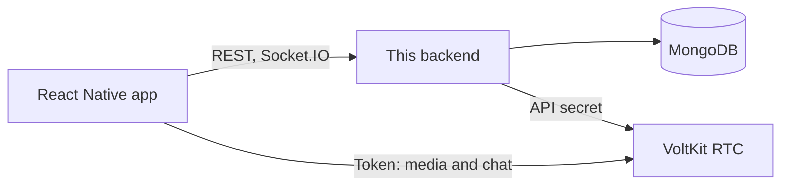

# VoltKit RTC: backend example

The Node.js backend for the [React Native example app](https://github.com/voltkit-rtc/react-native-example-audio-video). It shows how a real
product uses [`@voltkit-rtc/server`](https://voltkit.in/docs/server-sdk): creating rooms, minting tokens with the right role, keeping a live room list,
sending gifts through chat, and running 1v1 matching.

Built with Express, MongoDB and Socket.IO.

## What a VoltKit backend does

Audio and video go straight between the app and VoltKit, never through here. This backend has three jobs:

1. **Decide.** Who is this person, what may they join, and in what role? It answers by minting a short-lived token.
2. **Hold the secret.** The VoltKit API secret stays on the server, and apps only get tokens.
3. **Own what VoltKit does not.** Accounts, a list of rooms to browse, coins and gifts, conversations you want to keep, and reports.



## Start here

| I want to... | Read |
| --- | --- |
| Run this backend | [Run it](#run-it), below |
| Add VoltKit to my own backend | [Using the VoltKit server SDK](docs/voltkit-server-sdk.md) |
| See every endpoint and socket event | [API reference](docs/api-reference.md) |
| Deploy it | [Deployment](docs/deployment.md) |

## Where each SDK call lives

| Job | Code | SDK calls |
| --- | --- | --- |
| One client for the whole server | [`src/services/rtc.js`](src/services/rtc.js) | `new StreamClient`, `getBalance` |
| Rooms and tokens | [`src/services/rooms.js`](src/services/rooms.js) | `ensureRoom`, `createToken`, `listParticipants`, `listRooms`, `deleteRoom` |
| Gifts and entrance effects | [`src/routes/rooms.js`](src/routes/rooms.js), [`src/services/rooms.js`](src/services/rooms.js) | `sendMessage` |
| Lounge and direct messages | [`src/routes/chat.js`](src/routes/chat.js) | `createChatToken`, `sendMessage` |
| 1v1 calls | [`src/services/matchmaker.js`](src/services/matchmaker.js) | `ensureRoom`, `createToken`, `deleteRoom` |
| Prices for the app | [`src/routes/meta.js`](src/routes/meta.js) | `getRates` |
| Turning VoltKit errors into messages | [`src/errors.js`](src/errors.js) | `StreamError` |

## Run it

You need Node 20 or newer, MongoDB, and a [free VoltKit account](https://voltkit.in/rtc). Create a project in the dashboard to get your API URL and
secret.

```bash
git clone https://github.com/voltkit-rtc/voltkit-rtc-backend-demo.git
cd voltkit-rtc-backend-demo
npm install
cp .env.example .env
```

Fill in `.env`:

| Setting | What it is |
| --- | --- |
| `MONGODB_URI` | Any MongoDB connection string, Atlas included |
| `JWT_SECRET` | Signs guest sessions. Make one with `openssl rand -hex 32` |
| `VOLTKIT_RTC_URL` | From your project's Credentials tab |
| `VOLTKIT_RTC_SECRET` | From the same place. Keep it on the server |

Then start it:

```bash
npm run dev
curl http://localhost:4000/health   # {"ok":true}
```

The server checks your VoltKit secret on start, and exits with the reason if it is wrong. The gift catalog seeds itself.

## Tests

```bash
cp .env.test.example .env.test
npm test            # API, coins, matching, security. Needs MongoDB, not VoltKit
npm run test:live   # a short check against real VoltKit, with your .env
```

> [!CAUTION]
> `npm test` deletes the database named in `.env.test` between tests. Point it at a throwaway database, never at real data.

The tests replace VoltKit with an in-memory fake, [`FakeRtc`](test/helpers.js), so they run fast and cost nothing. The fake is passed in the same way the real
client is, which is why services receive `rtc` as an argument instead of importing it.

## Project layout

```text
src/
  server.js         Start-up: wires everything together
  app.js            Express: middleware and routes
  config.js         Reads and checks the environment
  errors.js         AppError, and VoltKit errors in plain words
  services/         rtc, rooms and matchmaker: the VoltKit logic
  routes/           guests, rooms, chat, meta
  realtime/         Socket.IO
  models/           Mongoose schemas
  middleware/       Auth, rate limits, error handling
  data/gifts.js     The gift catalog
public/svga/        Gift animations, served at /static
test/               Tests, and FakeRtc
```

## Tested with

`@voltkit-rtc/server` 0.4.11, Node 26 (the Docker image uses Node 24), Express 5, Mongoose 9, MongoDB Atlas. The room and 1v1 flows have also run against real VoltKit rooms, with
real audio and video, through a deployed copy of this backend.

## Licence

MIT, see [LICENSE](LICENSE). The VoltKit name and logo are not part of that licence.
